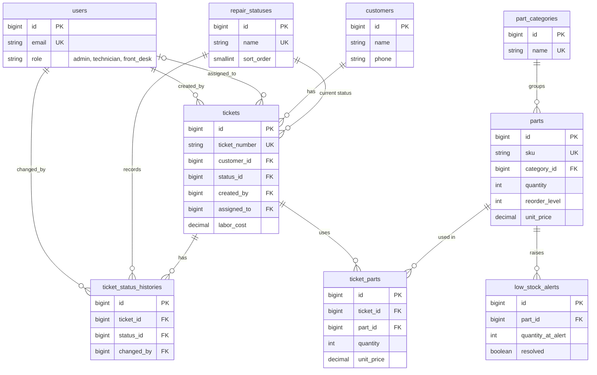

# Web-Based Repair Tracking and Parts Inventory System

Capstone project for a computer repair shop. Built with Laravel and PostgreSQL.
Covers the Web Development and Database Administration group outputs in one project.

## What it does

| Module | Who uses it | What it does |
|---|---|---|
| Intake | Front desk, admin | Creates a repair ticket with a ticket number (example: RT-2026-0001) |
| Repair tracker | Technician, admin | Updates status, assigns technician, records labor cost and parts used |
| Customer status page | Public, no login | Customer enters the ticket number and sees the current status and timeline |
| Parts inventory | Admin manages, everyone views | SKU, category, quantity, reorder level, price. Low-stock warning |
| Auto-deduction | Database trigger | Using a part on a ticket deducts stock. Removing it returns stock |
| Reports | Admin | Tickets per status and month, income, most used parts, low stock |
| Users | Admin | Change roles, delete accounts |
| Database page | Admin | Live view of the Database Administration work: connection settings, roles and privileges, keys, indexes with EXPLAIN, row-level security, function and triggers, backup and restore proof (menu: Database) |

### Roles (route protection by `EnsureRole` middleware)

| Action | admin | technician | front_desk | public |
|---|:-:|:-:|:-:|:-:|
| Check status by ticket number | yes | yes | yes | yes |
| View tickets and parts | yes | yes | yes | no |
| Create / edit tickets | yes | no | yes | no |
| Update progress, add or remove parts used | yes | yes | no | no |
| Delete tickets | yes | no | no | no |
| Add / edit / delete parts | yes | no | no | no |
| Reports, users, Database page | yes | no | no | no |

Technicians can only work on tickets that are unassigned or assigned to themselves. This is checked in `Ticket::canBeWorkedOnBy()` and again by the database (row-level security).

Public self-registration is disabled. Only an authenticated admin can create staff accounts from the Users page and assign an allowed role. The `role` column is not mass-assignable.

## Setup (Windows, macOS or Linux)

Requirements: PHP 8.2 or newer (with `pdo_pgsql`), Composer, PostgreSQL 14 or newer.

1. Create a fresh Laravel project and apply this project's files:
   ```
   composer create-project laravel/laravel repair-tracking
   bash apply-overlay.sh ../repair-tracking
   cd ../repair-tracking
   ```
   (On Windows run the script from Git Bash, or copy the folders `app config database resources routes scripts` and `.env.example` into the Laravel project yourself, then delete `database/migrations/0001_01_01_*.php` and `database/factories/UserFactory.php`.)
2. In pgAdmin or psql, create the database:
   ```
   CREATE DATABASE repair_tracking;
   ```
3. Open `.env` and set `DB_PASSWORD` for your `postgres` user. Then run:
   ```
   php artisan key:generate
   php artisan migrate:fresh --seed
   php artisan serve
   ```
4. Open http://localhost:8000

### Demo accounts

These accounts are for local demonstration only. Change or remove their credentials before deploying to production.

| Role | Email | Password |
|---|---|---|
| Admin | admin@repair.test | Admin@12345 |
| Technician | tech@repair.test | Tech@12345 |
| Front desk | desk@repair.test | Desk@12345 |

Demo ticket numbers for the public status page: RT-2026-0001 up to RT-2026-0008 (the year in the number is the year the seed was run).

### Database roles (Database Administration part)

After the migration and seed, run once as the superuser (run it again after every `migrate:fresh`, because the tables are recreated):

```
psql -U postgres -d repair_tracking -f database/sql/roles.sql
```

Then switch `.env` so the app runs with limited privileges:

```
DB_USERNAME=repair_app
DB_PASSWORD=app_pass_change_me
DB_READONLY_USERNAME=repair_readonly
DB_READONLY_PASSWORD=readonly_pass_change_me
```

To run migrations again, switch `DB_USERNAME` back to `postgres`.

| Role | Privileges | Used by |
|---|---|---|
| `postgres` (owner) | Everything, including DDL | Running migrations |
| `repair_app` | SELECT, INSERT, UPDATE, DELETE on data tables. No DDL. Cannot change `migrations`. Subject to row-level security | The Laravel app (default connection) |
| `repair_readonly` | SELECT only (own SELECT policies). No access to `users.password` | The Reports page (`pgsql_readonly` connection) |
| `repair_backup` | Read all data (`pg_read_all_data`) and `BYPASSRLS` so pg_dump sees every row. Cannot write | `scripts/backup.sh` |

The **Database** page in the app (admin menu) shows these roles and their table privileges live from PostgreSQL.

### Backup and restore

```
./scripts/backup.sh                                   # writes backups/repair_tracking_<timestamp>.dump
./scripts/restore.sh backups/<file>.dump              # restores into a NEW database and verifies
```

Environment variables (all optional): `DB_HOST`, `DB_PORT`, `DB_DATABASE`, `BACKUP_USER`, `BACKUP_PASSWORD`, `RESTORE_USER`, `RESTORE_PASSWORD`.
`restore.sh` creates `repair_tracking_restored`, restores the dump, then compares the row count of every table against the source and prints `RESTORE VERIFIED` only if they all match. The result is also saved to `backups/restore-verification.log`, which the **Database** page displays together with the list of backup files. This is the proof that the restore works.

### EXPLAIN demo

```
psql -U postgres -d repair_tracking -f database/sql/explain_demo.sql
```

| Query | Index used |
|---|---|
| Status page lookup by ticket number | `tickets_ticket_number_key` (unique index) |
| Ticket list by status, newest first | `idx_tickets_status_created` |
| Low-stock check | `idx_parts_low_stock` (partial index, `WHERE quantity <= reorder_level`) |
| Parts used on one ticket | `idx_ticket_parts_ticket` |

The **Database** page runs the same four EXPLAIN ANALYZE queries live and lists every index.

## Database design

### ERD



### Normalization (3NF) decisions

- **Customers are separate from tickets.** Name and phone depend on the customer, not on the ticket, so a returning customer is stored once (`unique(name, phone)`).
- **Statuses are a lookup table** (`repair_statuses`), not free text. A status name is stored once and tickets reference it by key, so renaming or reordering a status is one update.
- **Status history is separate** (`ticket_status_histories`). A ticket has one current status but many past ones, which is a one-to-many relationship and cannot live in a single column.
- **Part categories are separate** from parts so the category name is not repeated on every part row.
- **`ticket_parts` is the junction table** between tickets and parts (many-to-many). It stores `unit_price` at the time of use, on purpose: this is the historical price paid, not a copy of `parts.unit_price`. If the part price changes later, old tickets keep their correct totals.
- **Totals are not stored.** Parts cost and total cost are calculated by the view `v_ticket_totals` and by the model, so they can never go out of sync.

### Keys and constraints

- Primary keys on every table. Unique keys: `users.email`, `tickets.ticket_number`, `parts.sku`, `repair_statuses.name`, `part_categories.name`, `customers(name, phone)`.
- Foreign keys with explicit delete rules. `RESTRICT` where history must be kept (a part that was used cannot be deleted, a customer with tickets cannot be deleted). `CASCADE` for dependent rows (deleting a ticket deletes its history and parts rows). `SET NULL` for `tickets.assigned_to`.
- CHECK constraints: `role` in the allowed list, `quantity >= 0`, `reorder_level >= 0`, prices `>= 0`, `ticket_parts.quantity > 0`. Even if the app has a bug, the database will not accept negative stock.

### Function and triggers (`database/sql/functions_triggers_views.sql`)

- `fn_deduct_part_stock()` runs `BEFORE INSERT` on `ticket_parts`. It locks the part row (`FOR UPDATE`), raises an exception if stock is not enough, deducts the stock, and opens one row in `low_stock_alerts` when the new quantity is at or below the reorder level (never a duplicate while an alert is still open). Locking prevents two technicians from taking the last unit at the same time.
- `fn_restore_part_stock()` runs `AFTER DELETE` on `ticket_parts`, returns the quantity to stock and closes the open alert once stock is above the reorder level again. This also runs when a whole ticket is deleted, because of the cascade.
- Both functions are `SECURITY DEFINER`: they run with the owner's rights, so technicians can use parts without having write access to the `parts` table.
- Views: `v_low_stock_parts` (dashboard and reports) and `v_ticket_totals` (income report).

### Row-level security (`database/sql/rls.sql`)

The app signs in to PostgreSQL with one login (`repair_app`), so the database cannot tell staff apart by itself. The middleware `SetDatabaseContext` solves this: on every request it runs `set_config('app.role', ...)` and `set_config('app.user_id', ...)` with the Laravel user's role and id (`public` for a guest). The policies read those two settings through the helper functions `app_role()` and `app_user_id()`.

| Table | Who can do what |
|---|---|
| `tickets` | Everyone can read (customers use the status page). Insert and edit: admin, front desk. Technician can edit only unassigned tickets or their own. Delete: admin |
| `ticket_status_histories` | Read: everyone. Insert: admin, technician, front desk |
| `ticket_parts` | Read: staff. Insert and delete: admin, or a technician on an unassigned or own ticket |
| `parts` | Read: staff. Insert, update, delete: admin only. Stock moves only through the trigger |
| `low_stock_alerts` | Read: staff. Update: admin. Rows are created and closed by the trigger |

- If the app does not say who is calling, no row is visible (the policies fail closed).
- The table owner bypasses RLS, so `migrate:fresh --seed` runs normally as `postgres`. RLS applies once `.env` uses `repair_app`.
- `repair_backup` has `BYPASSRLS` and `repair_readonly` has its own SELECT policy (both in `roles.sql`).
- `users` and `customers` are protected by privileges and by the app, not by RLS: the login form must read `users` before anyone is identified.
- The **Database** page shows every policy and a live table of what each caller context can see and edit.

## Laravel and MVC

Request flow example, adding a part to a ticket:

1. **Route** `POST /tickets/{ticket}/parts` in `routes/web.php`
2. **Middleware** `auth`, then `EnsureRole:admin,technician`
3. **Controller** `TicketPartController@store` validates the input
4. **Model** `TicketPart::create(...)` inserts the row and the PostgreSQL trigger deducts the stock
5. **View** redirect back to `tickets/show.blade.php` with a success message. If stock was not enough, the exception from the trigger is caught and shown as a validation error.

| Topic | Where |
|---|---|
| Migrations | `database/migrations` (one per table, plus one for indexes, functions, triggers and views, and one for row-level security) |
| Seeding | `database/seeders`. Runs from a clean `php artisan migrate:fresh --seed` |
| Eloquent models and relationships | `app/Models` |
| Mass assignment | `$fillable` on every model. `User::role` is deliberately left out |
| Validation | Form Requests in `app/Http/Requests` (`TicketRequest`, `PartRequest`) and inline `validate()` in other controllers |
| Authentication | `AuthController`: login and logout; admins create accounts through `UserController` (passwords are hashed by the `hashed` cast) |
| Role checks | `EnsureRole` middleware in `app/Http/Middleware`, applied in `routes/web.php`. `SetDatabaseContext` passes the same role to PostgreSQL for RLS |
| CRUD on core entities | Tickets and Parts. Users also have edit and delete |
| Laravel connection settings | `.env`, `config/database.php` (`pgsql` and `pgsql_readonly`), shown on the Database page |

## Defense cheat sheet

- **Why a sequence for ticket numbers?** `nextval()` is atomic, so two tickets created at the same moment can never get the same number.
- **Why is the trigger in the database and not in PHP?** Any client that touches `ticket_parts` gets the same stock rules, and the check and the update happen in one transaction.
- **Why three database roles?** Least privilege. The app cannot drop tables, the report page cannot change data, and the backup account can read everything but write nothing.
- **Why does Reports use a second connection?** To show that the Laravel integration respects the read-only role.
- **How does row-level security know the user?** The app uses one database login, so `SetDatabaseContext` sends the Laravel user's role and id to PostgreSQL on every request (`set_config`). The policies read it. If it is missing, nothing is visible.
- **Why are the trigger functions SECURITY DEFINER?** A technician must be able to use parts, but only an admin may edit `parts`. The trigger runs with the owner's rights, so stock can only change through the trigger.
- **Why does the backup role have BYPASSRLS?** pg_dump refuses to run on tables with RLS unless it can see every row.
- **Where can I show all this in the app?** Admin menu, **Database** page.

## Folder map

```
app/Http/Controllers   one controller per module
app/Http/Middleware    EnsureRole, SetDatabaseContext
app/Support            DbContext (sends role and user id to PostgreSQL)
app/Http/Requests      form validation
app/Models             Eloquent models
config/database.php    PostgreSQL connections
database/migrations    tables
database/sql           triggers and views, row-level security, roles, EXPLAIN demo
database/seeders       demo data
resources/views        Blade pages
routes/web.php         routes and role groups
scripts                backup.sh, restore.sh (restore writes backups/restore-verification.log)
```
